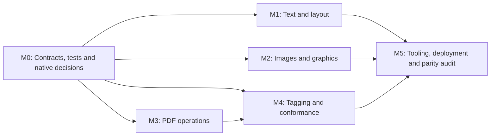

# FossPDF feature-parity roadmap

This is the shared implementation plan for functional parity with **QuestPDF 2026.9.1**. The initial target was established on **October 26, 2026**. Work is tracked in [the master issue](https://github.com/samuelkim-scz/FossPDF.Net/issues/1), [GitHub milestones](https://github.com/samuelkim-scz/FossPDF.Net/milestones), and the linked implementation issues below.

## Target and completion rules

- Reference release: [QuestPDF 2026.9.1](https://github.com/QuestPDF/QuestPDF/releases/tag/2026.9.1), commit `5a1422e15040484498236a5696d3aa9eefad8b10`.
- FossPDF baseline: [`0339255`](https://github.com/samuelkim-scz/FossPDF.Net/commit/0339255ff8f987a4abb62ef81f06bbcf00e0b81e), package version 2026.5.1.
- Primary application target: **.NET 9**. Preserve the core library's **netstandard2.1** compatibility and the existing .NET 8 / .NET 9 test coverage. New platform-specific capabilities must document their framework availability.
- Starting evidence: clean Release build with zero warnings/errors; 156 tests passing on .NET 8 and 157 on .NET 9, plus the existing preview-protocol and rendering smoke checks.
- Parity means equivalent documented capabilities and observable outcomes. Keep FossPDF namespaces and existing APIs, and document aliases or equivalent workflows. Rendering comparisons use declared tolerances and semantic checks.
- Keep the repository's MIT licensing and required third-party notices. Independently implement features and record the licenses, packaging and maintenance requirements of added dependencies.
- Every in-scope work item must have merged implementation, acceptance evidence, documentation and a working example before the pinned target is declared complete. Priority determines sequencing; it does not remove lower-priority features from the target.

[The versioned baseline manifest](docs/feature-parity/baseline-2026.9.1.json) records the initial assessment, work definitions and issue identifiers. **GitHub issues are the source of truth for ownership, discussion, blockers and completion.** Baseline assessments below describe the starting code, not live implementation status.

[The acceptance specification](docs/feature-parity/ACCEPTANCE.md) defines public behavioral contracts, stable fixture IDs, expected outcomes, visual tolerances and commands for running the shared corpus.

[The settings contract](docs/feature-parity/SETTINGS.md) defines document/output defaults, compatibility mappings, concurrency and ownership rules for dependent feature work.

[The image optimization guide](docs/feature-parity/IMAGE_OPTIMIZATION.md) covers per-image raster DPI, resampling, JPEG/WebP quality, document defaults and shared-image ownership.

[The layout helpers guide](docs/feature-parity/LAYOUT_HELPERS.md) covers per-axis shrinking, z-index composition and alignment of content injected into text.

[The deferred composition guide](docs/feature-parity/LAZY_COMPOSITION.md) covers Lazy/LazyWithCache lifecycle, cache trade-offs, failure rules and resource ownership.

[The text features guide](docs/feature-parity/TEXT_FEATURES.md) covers OpenType feature toggles and underline/overline/strikethrough color, thickness and style controls.

[The image export guide](docs/feature-parity/IMAGE_EXPORT.md) covers PNG/JPEG/WebP quality, DPI, transparency, backgrounds and caller-owned output streams.

[The PDF operations guide](docs/feature-parity/PDF_OPERATIONS.md) covers loading existing PDFs, page selectors, merging, metadata/annotation preservation and failure/ownership rules.

[The PDF security guide](docs/feature-parity/PDF_SECURITY.md) covers password-based encryption strengths, permission flags, decryption and password-handling boundaries.

[The PDF attachments guide](docs/feature-parity/PDF_ATTACHMENTS.md) covers embedded files, associated-file relationships, Unicode names and XMP metadata extensions.

[The PDF optimization guide](docs/feature-parity/PDF_OPTIMIZATION.md) covers explicit additional compression, intentional decompression and linearization through an external qpdf executable, including discovery, measured size behavior, interactions and failure handling.

[The tagged PDF guide](docs/feature-parity/PDF_ACCESSIBILITY.md) covers semantic wrappers, automatic artifact tagging, alternative text and language, reading order, links, page breaks and the structure/parent-tree output produced by the optional PDF operations companion.

[The PDF/A conformance guide](docs/feature-parity/PDF_A_CONFORMANCE.md) covers the six selectable PDF/A-2/PDF/A-3 levels, settings versus explicit selection, the legacy flag mapping, accessibility and Unicode requirements, PDF/A-3 attachments, rejected combinations and the pinned veraPDF validation.

## Confirmed gaps and capabilities to validate

| Capability | Baseline assessment | Target behavior / current distinction | Work items | QuestPDF reference | FossPDF baseline evidence |
| --- | --- | --- | --- | --- | --- |
| Existing-PDF processing | Missing | Load/save existing PDFs; merge, extract/reorder pages, overlays/underlays, security, attachments/XMP. | FP-302–FP-306 | [Reference](https://www.questpdf.com/concepts/document-operations.html) | [Generation-only API](https://github.com/samuelkim-scz/FossPDF.Net/blob/0339255ff8f987a4abb62ef81f06bbcf00e0b81e/Source/FossPDF/Fluent/GenerateExtensions.cs) |
| Generated-document merge strategies | Missing | Merge IDocument instances with original or continuous page numbering. | [FP-301 / #20](https://github.com/samuelkim-scz/FossPDF.Net/issues/20) | [Reference](https://github.com/QuestPDF/QuestPDF/blob/2026.9.1/src/dotnet/library/QuestPDF/Infrastructure/IMergedDocument.cs) | [Document API](https://github.com/samuelkim-scz/FossPDF.Net/blob/0339255ff8f987a4abb62ef81f06bbcf00e0b81e/Source/FossPDF/Fluent/MinimalApi.cs) |
| Extra compression / linearization controls | Partial | Underlying renderer compression exists; explicit additional optimization and web-linearized output are missing. | [FP-306 / #25](https://github.com/samuelkim-scz/FossPDF.Net/issues/25) | [Reference](https://www.questpdf.com/concepts/document-settings.html) | [Metadata/settings](https://github.com/samuelkim-scz/FossPDF.Net/blob/0339255ff8f987a4abb62ef81f06bbcf00e0b81e/Source/FossPDF/Drawing/DocumentMetadata.cs) |
| Tagged PDF / PDF/UA-1 | Missing | Semantic roles, reading order, language, alt text and validated universal-accessibility output. | FP-401, FP-403 | [Reference](https://www.questpdf.com/concepts/accessibility.html) | [Drawing contract](https://github.com/samuelkim-scz/FossPDF.Net/blob/0339255ff8f987a4abb62ef81f06bbcf00e0b81e/Source/FossPDF/Infrastructure/ICanvas.cs) |
| Selectable PDF/A-2 / PDF/A-3 levels | Partial | A PdfA boolean exists; six selectable A/B/U conformance levels and validation are missing. | [FP-402 / #27](https://github.com/samuelkim-scz/FossPDF.Net/issues/27) | [Reference](https://www.questpdf.com/concepts/document-settings.html) | [Existing PdfA flag](https://github.com/samuelkim-scz/FossPDF.Net/blob/0339255ff8f987a4abb62ef81f06bbcf00e0b81e/Source/FossPDF/Drawing/DocumentMetadata.cs) |
| Structured e-invoice packaging | Missing | Associated invoice XML and XMP packaging for declared ZUGFeRD / Factur-X profiles. | [FP-404 / #29](https://github.com/samuelkim-scz/FossPDF.Net/issues/29) | [Reference](https://www.questpdf.com/concepts/document-operations.html) | [Current PDF backend](https://github.com/samuelkim-scz/FossPDF.Net/blob/0339255ff8f987a4abb62ef81f06bbcf00e0b81e/Source/FossPDF/Drawing/PdfCanvas.cs) |
| Paragraph / advanced text features | Partial | Justification, logical start/end alignment, first-line indentation, word spacing, clamping/ellipsis, OpenType controls and richer decorations. | FP-101–FP-103 | [Reference](https://www.questpdf.com/api-reference/text/paragraph-style.html) | [Text API](https://github.com/samuelkim-scz/FossPDF.Net/blob/0339255ff8f987a4abb62ef81f06bbcf00e0b81e/Source/FossPDF/Fluent/TextExtensions.cs) |
| Newspaper-style column flow | Missing | Single-stream multi-column flow, balancing and separator content. | [FP-104 / #9](https://github.com/samuelkim-scz/FossPDF.Net/issues/9) | [Reference](https://www.questpdf.com/api-reference/multi-column.html) | [Existing vertical stack](https://github.com/samuelkim-scz/FossPDF.Net/blob/0339255ff8f987a4abb62ef81f06bbcf00e0b81e/Source/FossPDF/Fluent/ColumnExtensions.cs) |
| Pagination helpers | Partial | PreventPageBreak, standalone Repeat and page-aware ShowIf predicates; basic ShowIf and other page controls already exist. | [FP-105 / #10](https://github.com/samuelkim-scz/FossPDF.Net/issues/10) | [Reference](https://github.com/QuestPDF/QuestPDF/blob/2026.9.1/src/dotnet/library/QuestPDF/Fluent/ElementExtensions.cs) | [Existing flow controls](https://github.com/samuelkim-scz/FossPDF.Net/blob/0339255ff8f987a4abb62ef81f06bbcf00e0b81e/Source/FossPDF/Fluent/ElementExtensions.cs) |
| Deferred composition | Missing | Lazy and LazyWithCache with tested object/native-resource lifetimes. | [FP-106 / #11](https://github.com/samuelkim-scz/FossPDF.Net/issues/11) | [Reference](https://www.questpdf.com/api-reference/lazy.html) | [Rendering pipeline](https://github.com/samuelkim-scz/FossPDF.Net/blob/0339255ff8f987a4abb62ef81f06bbcf00e0b81e/Source/FossPDF/Drawing/DocumentGenerator.cs) |
| Layout helper / inline alignment APIs | Partial | Per-axis shrinking, generic ZIndex, and configurable inline-element baseline/top/bottom/middle alignment. | [FP-107 / #12](https://github.com/samuelkim-scz/FossPDF.Net/issues/12) | [Reference](https://github.com/QuestPDF/QuestPDF/blob/2026.9.1/src/dotnet/library/QuestPDF/Fluent/ElementExtensions.cs) | [MinimalBox equivalent](https://github.com/samuelkim-scz/FossPDF.Net/blob/0339255ff8f987a4abb62ef81f06bbcf00e0b81e/Source/FossPDF/Elements/MinimalBox.cs) |
| Content geometry capture | Missing | Supported element IDs, page positions/sizes and fragment/occurrence geometry for dynamic content and tooling. | [FP-108 / #13](https://github.com/samuelkim-scz/FossPDF.Net/issues/13) | [Reference](https://www.questpdf.com/concepts/code-patterns/capture-content-position.html) | [Current page context](https://github.com/samuelkim-scz/FossPDF.Net/blob/0339255ff8f987a4abb62ef81f06bbcf00e0b81e/Source/FossPDF/Infrastructure/PageContext.cs) |
| First-class SVG input | Partial | SVG export and external Canvas/Svg.Skia integration exist; a core SVG input/preload/font-integration API is missing. | [FP-201 / #15](https://github.com/samuelkim-scz/FossPDF.Net/issues/15) | [Reference](https://www.questpdf.com/api-reference/image/svg.html) | [Current SVG input example](https://github.com/samuelkim-scz/FossPDF.Net/blob/0339255ff8f987a4abb62ef81f06bbcf00e0b81e/Source/FossPDF.Examples/SvgImageExample.cs) |
| Image optimization / image output | Partial | Per-image DPI/quality controls and configurable JPEG/WebP page export; PNG output/shared images already exist. | FP-202, FP-203 | [Reference](https://www.questpdf.com/api-reference/image/optimization.html) | [PNG-only page encoder](https://github.com/samuelkim-scz/FossPDF.Net/blob/0339255ff8f987a4abb62ef81f06bbcf00e0b81e/Source/FossPDF/Drawing/ImageCanvas.cs) |
| Modern graphics styling | Partial | Rounded corners, border alignment, gradients, configurable line dashes and shadows as supported fluent APIs. | FP-204, FP-205 | [Reference](https://www.questpdf.com/api-reference/rounded-corners.html) | [Current border API](https://github.com/samuelkim-scz/FossPDF.Net/blob/0339255ff8f987a4abb62ef81f06bbcf00e0b81e/Source/FossPDF/Fluent/BorderExtensions.cs) |
| Companion-style developer tooling | Partial | Element hierarchy/inspection, measurement, coordinate picking, search, source navigation and richer layout diagnostics. | FP-501, FP-502 | [Reference](https://www.questpdf.com/companion/features.html) | [Existing previewer](https://github.com/samuelkim-scz/FossPDF.Net/blob/0339255ff8f987a4abb62ef81f06bbcf00e0b81e/Source/FossPDF.Previewer/InteractiveCanvas.cs) |
| Complex scripts / mixed direction / CJK | Validation required | HarfBuzz shaping, font fallback and RTL exist; qualify observable edge cases and fix reproduced gaps. | [FP-109 / #14](https://github.com/samuelkim-scz/FossPDF.Net/issues/14) | [Reference](https://www.questpdf.com/api-reference/text/text-style.html) | [Existing text shaper](https://github.com/samuelkim-scz/FossPDF.Net/blob/0339255ff8f987a4abb62ef81f06bbcf00e0b81e/Source/FossPDF/Drawing/TextShaper.cs) |
| NativeAOT / trimming / platform qualification | Validation required | QuestPDF declares AOT support; this repository needs publish-and-run evidence for each claimed configuration. | [FP-503 / #32](https://github.com/samuelkim-scz/FossPDF.Net/issues/32) | [Reference](https://github.com/QuestPDF/QuestPDF/blob/2026.9.1/src/dotnet/library/QuestPDF/QuestPDF.csproj) | [Reflection/interop audit target](https://github.com/samuelkim-scz/FossPDF.Net/blob/0339255ff8f987a4abb62ef81f06bbcf00e0b81e/Source/FossPDF.FontSubset/FontSubsetBuilder.cs) |

FossPDF already provides the fluent document model, pages, rows/columns, tables and spanning, layers, headers/footers, links/sections, page numbering, dynamic components, continuous pages, basic RTL/text shaping, font fallback, shared images, optional font subsetting, PDF/XPS/PNG output and SVG export. Existing integrations for charts, barcodes and custom Skia graphics should be retained and expanded through the relevant examples, rather than counted as wholly absent features.

**Target boundaries:** PDF/A-4, PDF/UA-2, built-in X.509 signing, AcroForm creation and general PDF text/content extraction appear on [QuestPDF's future roadmap](https://www.questpdf.com/roadmap.html); they are outside this pinned released-feature target. NativeAOT, platform support, mixed-script behavior and performance require measured qualification instead of assumptions about current FossPDF limitations.

## Milestones and parallel work

Milestones can overlap. Dependencies gate acceptance and integration; contributors can start design/prototypes earlier against agreed contracts. No delivery dates or staffing commitments are assumed.

| Milestone | Outcome | Initial work items |
| --- | --- | --- |
| [M0](https://github.com/samuelkim-scz/FossPDF.Net/milestone/1) | Define testable contracts, compatible settings, native-backend decisions, and reproducible quality baselines. | FP-001, FP-002, FP-003, FP-004 |
| [M1](https://github.com/samuelkim-scz/FossPDF.Net/milestone/2) | Deliver paragraph, typography, pagination, multi-column, lazy, geometry, and layout API parity. | FP-101, FP-102, FP-103, FP-104, FP-105, FP-106, FP-107, FP-108, FP-109 |
| [M2](https://github.com/samuelkim-scz/FossPDF.Net/milestone/3) | Deliver SVG input, image optimization/output controls, and modern container/line styling. | FP-201, FP-202, FP-203, FP-204, FP-205 |
| [M3](https://github.com/samuelkim-scz/FossPDF.Net/milestone/4) | Deliver generated-document merging and existing-PDF processing, security, attachments, and optimization. | FP-301, FP-302, FP-303, FP-304, FP-305, FP-306 |
| [M4](https://github.com/samuelkim-scz/FossPDF.Net/milestone/5) | Deliver tagged PDF, the six PDF/A-2/PDF/A-3 conformance levels, PDF/UA-1, and validated e-invoice packaging. | FP-401, FP-402, FP-403, FP-404 |
| [M5](https://github.com/samuelkim-scz/FossPDF.Net/milestone/6) | Deliver inspection tooling, qualify NativeAOT/platform support, and publish the final evidence-based parity audit. | FP-501, FP-502, FP-503, FP-504 |



**Ready for the first contributors:** FP-001 (spec/fixtures), FP-002 (native architecture), FP-003 (quality/performance baseline), and FP-004 (settings/API contract). These can be claimed independently. Follow-on work becomes ready when its blocking issues are resolved or an agreed stable contract allows safe parallel implementation.

Sizes are relative complexity: S = localized, M = moderate, L = cross-cutting, XL = major subsystem. They are not person-day estimates. Split XL work into smaller sub-issues and scoped pull requests while keeping its parent acceptance criteria intact.

## Implementation issue index

Each issue carries its acceptance checklist, validation requirements, likely touchpoints and reference links. Assignment and completion are maintained on GitHub, so this document does not duplicate live status or owner fields.

### [Parity M0 - Baseline and architecture](https://github.com/samuelkim-scz/FossPDF.Net/milestone/1)

Define testable contracts, compatible settings, native-backend decisions, and reproducible quality baselines. The runnable baseline tool, tolerances, performance budgets and CI artifacts are documented in [docs/feature-parity/QUALITY.md](docs/feature-parity/QUALITY.md). The native-backend decision, dependency/licence inventory and prototypes are in [ADR-0001](docs/feature-parity/decisions/ADR-0001-native-backends.md), [NATIVE_DEPENDENCIES.md](docs/feature-parity/NATIVE_DEPENDENCIES.md) and [fp-002-windows.md](docs/feature-parity/evidence/fp-002-windows.md).

| ID / issue | Work package | Priority | Size | Depends on |
| --- | --- | --- | --- | --- |
| [FP-001 / #2](https://github.com/samuelkim-scz/FossPDF.Net/issues/2) | Define the parity specification and acceptance fixtures | P0 | M | None |
| [FP-002 / #3](https://github.com/samuelkim-scz/FossPDF.Net/issues/3) | Choose native backends and dependency contracts | P0 | L | None |
| [FP-003 / #4](https://github.com/samuelkim-scz/FossPDF.Net/issues/4) | Establish cross-platform visual, conformance and performance baselines | P0 | L | None |
| [FP-004 / #5](https://github.com/samuelkim-scz/FossPDF.Net/issues/5) | Define per-document settings and compatibility rules | P0 | M | None |

### [Parity M1 - Text and layout](https://github.com/samuelkim-scz/FossPDF.Net/milestone/2)

Deliver paragraph, typography, pagination, multi-column, lazy, geometry, and layout API parity. Line clamping and custom ellipsis behavior are documented in [docs/feature-parity/TEXT_CLAMPING.md](docs/feature-parity/TEXT_CLAMPING.md). Content-position capture behavior, units and two-pass semantics are documented in [docs/feature-parity/CONTENT_POSITIONS.md](docs/feature-parity/CONTENT_POSITIONS.md).

| ID / issue | Work package | Priority | Size | Depends on |
| --- | --- | --- | --- | --- |
| [FP-101 / #6](https://github.com/samuelkim-scz/FossPDF.Net/issues/6) | Add paragraph justification, logical alignment, indentation and word spacing | P1 | L | FP-001, FP-004 |
| [FP-102 / #7](https://github.com/samuelkim-scz/FossPDF.Net/issues/7) | Add text line clamping and custom ellipses | P1 | M | [FP-001 / #2](https://github.com/samuelkim-scz/FossPDF.Net/issues/2) |
| [FP-103 / #8](https://github.com/samuelkim-scz/FossPDF.Net/issues/8) | Add OpenType controls and richer text decorations | P1 | L | FP-001, FP-002 |
| [FP-104 / #9](https://github.com/samuelkim-scz/FossPDF.Net/issues/9) | Implement newspaper-style multi-column flow and balancing | P1 | XL | [FP-001 / #2](https://github.com/samuelkim-scz/FossPDF.Net/issues/2) |
| [FP-105 / #10](https://github.com/samuelkim-scz/FossPDF.Net/issues/10) | Add PreventPageBreak, Repeat and page-aware conditional rendering | P1 | M | [FP-001 / #2](https://github.com/samuelkim-scz/FossPDF.Net/issues/2) |
| [FP-106 / #11](https://github.com/samuelkim-scz/FossPDF.Net/issues/11) | Implement Lazy and LazyWithCache composition | P1 | L | FP-001, FP-002 |
| [FP-107 / #12](https://github.com/samuelkim-scz/FossPDF.Net/issues/12) | Complete layout helpers and inline-element alignment | P2 | M | [FP-001 / #2](https://github.com/samuelkim-scz/FossPDF.Net/issues/2) |
| [FP-108 / #13](https://github.com/samuelkim-scz/FossPDF.Net/issues/13) | Add content-position capture and dynamic geometry access | P1 | M | [FP-001 / #2](https://github.com/samuelkim-scz/FossPDF.Net/issues/2) |
| [FP-109 / #14](https://github.com/samuelkim-scz/FossPDF.Net/issues/14) | Qualify complex-script, mixed-direction and CJK behavior | P1 | L | FP-001, FP-002 |

### [Parity M2 - Images and graphics](https://github.com/samuelkim-scz/FossPDF.Net/milestone/3)

Deliver SVG input, image optimization/output controls, and modern container/line styling.

| ID / issue | Work package | Priority | Size | Depends on |
| --- | --- | --- | --- | --- |
| [FP-201 / #15](https://github.com/samuelkim-scz/FossPDF.Net/issues/15) | Add first-class SVG input and preloading | P1 | L | FP-002, FP-004 |
| [FP-202 / #16](https://github.com/samuelkim-scz/FossPDF.Net/issues/16) | Add per-image DPI, resampling and compression quality controls | P1 | M | [FP-004 / #5](https://github.com/samuelkim-scz/FossPDF.Net/issues/5) |
| [FP-203 / #17](https://github.com/samuelkim-scz/FossPDF.Net/issues/17) | Add JPEG and WebP page export settings | P1 | S | [FP-004 / #5](https://github.com/samuelkim-scz/FossPDF.Net/issues/5) |
| [FP-204 / #18](https://github.com/samuelkim-scz/FossPDF.Net/issues/18) | Add rounded containers, border alignment and gradients | P1 | L | [FP-002 / #3](https://github.com/samuelkim-scz/FossPDF.Net/issues/3) |
| [FP-205 / #19](https://github.com/samuelkim-scz/FossPDF.Net/issues/19) | Add advanced line styles and shadows | P2 | L | FP-002, FP-204 |

### [Parity M3 - PDF document operations](https://github.com/samuelkim-scz/FossPDF.Net/milestone/4)

Deliver generated-document merging and existing-PDF processing, security, attachments, and optimization. Generated-document merging behavior, precedence and ownership are documented in [docs/feature-parity/MERGING.md](docs/feature-parity/MERGING.md). Existing-PDF loading, page selection and merging are documented in [docs/feature-parity/PDF_OPERATIONS.md](docs/feature-parity/PDF_OPERATIONS.md), overlays and underlays in [docs/feature-parity/PDF_LAYERS.md](docs/feature-parity/PDF_LAYERS.md), encryption, permissions and decryption in [docs/feature-parity/PDF_SECURITY.md](docs/feature-parity/PDF_SECURITY.md), attachments and XMP extensions in [docs/feature-parity/PDF_ATTACHMENTS.md](docs/feature-parity/PDF_ATTACHMENTS.md), and explicit compression and linearization in [docs/feature-parity/PDF_OPTIMIZATION.md](docs/feature-parity/PDF_OPTIMIZATION.md).

| ID / issue | Work package | Priority | Size | Depends on |
| --- | --- | --- | --- | --- |
| [FP-301 / #20](https://github.com/samuelkim-scz/FossPDF.Net/issues/20) | Add generated-document merging and page-number strategies | P1 | M | FP-001, FP-004 |
| [FP-302 / #21](https://github.com/samuelkim-scz/FossPDF.Net/issues/21) | Implement existing-PDF loading, saving, page selection and merging | P1 | XL | FP-002, FP-004 |
| [FP-303 / #22](https://github.com/samuelkim-scz/FossPDF.Net/issues/22) | Add existing-PDF overlays and underlays | P1 | M | [FP-302 / #21](https://github.com/samuelkim-scz/FossPDF.Net/issues/21) |
| [FP-304 / #23](https://github.com/samuelkim-scz/FossPDF.Net/issues/23) | Add PDF encryption, decryption and permissions | P1 | L | [FP-302 / #21](https://github.com/samuelkim-scz/FossPDF.Net/issues/21) |
| [FP-305 / #24](https://github.com/samuelkim-scz/FossPDF.Net/issues/24) | Add attachments, associated-file relationships and XMP extensions | P1 | L | [FP-302 / #21](https://github.com/samuelkim-scz/FossPDF.Net/issues/21) |
| [FP-306 / #25](https://github.com/samuelkim-scz/FossPDF.Net/issues/25) | Add explicit PDF compression and linearization controls | P1 | M | FP-302, FP-004 |

### [Parity M4 - Accessibility and conformance](https://github.com/samuelkim-scz/FossPDF.Net/milestone/5)

Deliver tagged PDF, the six PDF/A-2/PDF/A-3 conformance levels, PDF/UA-1, and validated e-invoice packaging. Tagged structure and artifacts are documented in [docs/feature-parity/PDF_ACCESSIBILITY.md](docs/feature-parity/PDF_ACCESSIBILITY.md), selectable PDF/A levels, attachments and profile validation in [docs/feature-parity/PDF_A_CONFORMANCE.md](docs/feature-parity/PDF_A_CONFORMANCE.md).

| ID / issue | Work package | Priority | Size | Depends on |
| --- | --- | --- | --- | --- |
| [FP-401 / #26](https://github.com/samuelkim-scz/FossPDF.Net/issues/26) | Implement semantic structure and tagged PDF | P1 | XL | FP-002, FP-004 |
| [FP-402 / #27](https://github.com/samuelkim-scz/FossPDF.Net/issues/27) | Add selectable PDF/A-2 and PDF/A-3 conformance levels | P1 | XL | FP-002, FP-305, FP-401 |
| [FP-403 / #28](https://github.com/samuelkim-scz/FossPDF.Net/issues/28) | Implement PDF/UA-1 accessibility conformance | P1 | XL | [FP-401 / #26](https://github.com/samuelkim-scz/FossPDF.Net/issues/26) |
| [FP-404 / #29](https://github.com/samuelkim-scz/FossPDF.Net/issues/29) | Add validated ZUGFeRD and Factur-X packaging workflows | P1 | L | FP-305, FP-402 |

### [Parity M5 - Tooling, deployment and release](https://github.com/samuelkim-scz/FossPDF.Net/milestone/6)

Deliver inspection tooling, qualify NativeAOT/platform support, and publish the final evidence-based parity audit.

| ID / issue | Work package | Priority | Size | Depends on |
| --- | --- | --- | --- | --- |
| [FP-501 / #30](https://github.com/samuelkim-scz/FossPDF.Net/issues/30) | Add previewer element-inspection transport and source mapping | P1 | L | FP-108, FP-002 |
| [FP-502 / #31](https://github.com/samuelkim-scz/FossPDF.Net/issues/31) | Add interactive inspection, measurement, search and source navigation | P2 | XL | [FP-501 / #30](https://github.com/samuelkim-scz/FossPDF.Net/issues/30) |
| [FP-503 / #32](https://github.com/samuelkim-scz/FossPDF.Net/issues/32) | Qualify NativeAOT, trimming and runtime asset support | P1 | L | FP-002, FP-201 |
| [FP-504 / #33](https://github.com/samuelkim-scz/FossPDF.Net/issues/33) | Complete the parity audit, migration guide and release evidence | P0 | L | All preceding in-scope work |

## Contributor workflow

1. Choose an open work item whose blockers are understood. Request assignment in that issue; a contributor with repository permissions can assign themselves. Record one lead assignee and collaborating contributors in the issue discussion.
2. Describe the proposed public API, framework availability and affected modules before broad implementation. Coordinate shared contracts in the dependent issues and use draft PRs to make concurrent work visible.
3. Create a focused branch and a small PR linked to the work item. Use `Closes #<number>` when the PR completes the whole issue; use `Refs #<number>` for partial progress.
4. Include acceptance evidence, regression tests, docs/examples, compatibility notes and third-party notices. Add or remove GitHub blocker relationships when dependencies change.
5. Request review, resolve feedback and close the work item only after its full acceptance checklist is met. Closing issues updates native sub-issue and milestone progress. Split work remains open until all required child tasks are accepted.
6. At regular contributor triage, review unassigned work, blocked items, active PRs, quality results and scope changes. Scope changes must update the relevant issues and this roadmap/manifest with the reference release and evidence.

Ownership and state are represented by GitHub assignees, open/closed state, native blockers, milestones and linked PRs. Labels classify `feature-parity`, area and priority. Use `status:in-progress` and `status:review` when helpful; remove stale status labels when work closes or changes hands. Never close an item merely because an API stub or setting exists.

### Coordination boundaries

- Text work shares `TextBlock`, `TextShaper`, text-style caches and font subsetting; agree the style/layout contract before parallel edits to those files.
- Graphics work shares `ICanvas`, native object ownership and output fallbacks; merge shared interfaces before competing implementations.
- Layout work shares rendering state, reset/replay behavior and page context. Iterative measurement must not consume content or destabilize total page counts.
- PDF operations and conformance share metadata, attachments and native backends. Integration fixtures must exercise their combinations, not just isolated APIs.
- Preview inspection consumes the public geometry/source contracts. Keep the protocol versioned and compatible with existing preview clients.

## Definition of done and release gates

- Clean .NET 9 consumer build; existing supported APIs and core target frameworks preserved.
- Release build passes with warnings treated as errors; all .NET 8 / .NET 9 tests pass.
- Feature-specific semantic, layout, failure and ownership tests pass; representative visual fixtures are reviewed using the declared tolerances.
- Windows, Linux and macOS checks pass for claimed-supported features, with explicit runtime/architecture evidence for deployment claims.
- Public APIs have documentation, a runnable example and compatibility notes; new dependencies have recorded licenses/notices and packaged runtime assets.
- PDF/A, PDF/UA and e-invoice claims have validator reports for the exact declared profiles. PDF/UA also requires recorded human accessibility checks.
- Performance and large-document memory results meet the measured budgets established in FP-003, or have an explicitly reviewed and documented tradeoff.
- The final FP-504 audit reconciles every target row and links release evidence. Benchmark marketing claims or setting an enum alone do not constitute parity.

Run the baseline checks from `Source`:

```powershell
dotnet restore FossPDF.sln
dotnet build FossPDF.sln -c Release --no-restore --warnaserror
dotnet test FossPDF.UnitTests/FossPDF.UnitTests.csproj -c Release --no-build --no-restore
```

## Keeping the target current

The target stays at QuestPDF 2026.9.1 until this milestone set is audited. Check new upstream releases during regular triage and record newly shipped capabilities as a separately versioned target/backlog. Verify website descriptions against the pinned source/release when they diverge. Preserve completed issue history and publish target changes through a reviewed documentation update.

See [CONTRIBUTING.md](CONTRIBUTING.md) for the repository workflow and [the parity issue form](.github/ISSUE_TEMPLATE/parity_feature.yml) for new work packages.
